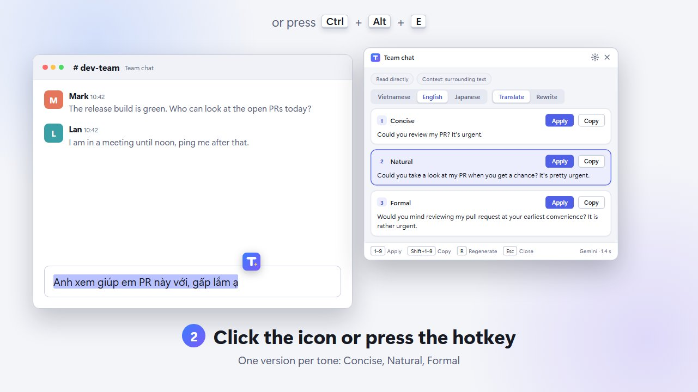

<div align="center">


# ToneSnap

**Select text in any app, press a hotkey, and get it back in the tone you need.**

[Website](https://nhutruong-struct.github.io/struct-tonesnap/) · [Discussions](https://github.com/nhutruong-struct/struct-tonesnap/discussions) · [Roadmap](docs/PLAN.md) · [Contributing](CONTRIBUTING.md)

[](https://github.com/nhutruong-struct/struct-tonesnap/actions/workflows/ci.yml)
[](LICENSE)
[](#status)
[](https://github.com/nhutruong-struct/struct-tonesnap/discussions)
[](https://scorecard.dev/viewer/?uri=github.com/nhutruong-struct/struct-tonesnap)
[](CONTRIBUTING.md)
[](https://github.com/sponsors/nhutruong-struct)

</div>

ToneSnap is a small desktop app for people who work in Vietnamese, English and Japanese, especially Vietnamese
speakers writing English. Select a sentence in Slack, Outlook, Teams, a browser or any other app, click the
floating icon next to the selection (or press `Ctrl+Alt+E`), and a popup suggests several versions, each in a
different tone, in the language you choose. **Apply** pastes the version you pick back in place of the selection.

<p align="center">
  <a href="https://nhutruong-struct.github.io/struct-tonesnap/#demo">
    
  </a>
  <br>
  <a href="https://nhutruong-struct.github.io/struct-tonesnap/#demo">Watch the 80-second intro</a>
</p>

## Features

- **Works in any app.** Reads the selection through UI Automation, falls back to the clipboard, and to on-device
  OCR when neither works. Your clipboard is always restored.
- **Translate or rewrite, in Vietnamese, English or Japanese.** Pick the target language (Vietnamese by default)
  and a mode, **Translate** (close to the original) or **Rewrite** (rephrased freely), right in the popup.
- **Several tones at once:** concise, natural and formal.
- **Apply in place.** Replaces the selection in the original app when the field is editable; **Copy** otherwise.
- **Privacy first.** Emails, phone numbers, IDs, card numbers, URLs, API keys and your own terms are redacted
  before anything is sent, and restored for display. Password fields and apps you block are never read.
  Nothing is logged or stored, and there is no telemetry. See [docs/specs/privacy.md](docs/specs/privacy.md).
- **Bring your own key.** Google Gemini (free tier, default), Groq (free tier), OpenRouter (free models) or the
  Claude API (paid). Keys are kept in Windows Credential Manager.
- **Updates itself.** New versions come from the GitHub releases: downloaded in the background and installed
  while you are not using ToneSnap, or only announced if you prefer to ask first.
- **Vietnamese and English interface**, light and dark themes, start with Windows, tray menu.

## Status

ToneSnap runs on **Windows 10/11**. **macOS 14 or later (Apple Silicon)** is supported too: the releases carry a signed and notarized `ToneSnap_x.y.z_aarch64.dmg` (see [Run on a Mac](#run-on-a-mac)). On Windows, download `ToneSnap_x.y.z_x64-setup.exe` from the
[latest release](https://github.com/nhutruong-struct/struct-tonesnap/releases/latest) (or use the
**Download for Windows** button on the [website](https://nhutruong-struct.github.io/struct-tonesnap/)), or build it from source
as described below. The installers are not code-signed yet, so Windows SmartScreen asks for confirmation the
first time (**More info → Run anyway**). See the [changelog](CHANGELOG.md) for what is in each version.

## Getting started

To just use ToneSnap, run the installer from the [latest release](https://github.com/nhutruong-struct/struct-tonesnap/releases/latest)
and go to [Choose an AI provider](#choose-an-ai-provider). The rest of this section is for building from source.

### Requirements

- Windows 10 or 11
- [Rust](https://rustup.rs/) (stable, MSVC toolchain) and Visual Studio Build Tools with
  "Desktop development with C++"
- [Node.js](https://nodejs.org/) 20 or newer and [pnpm](https://pnpm.io/) 10
- [WebView2](https://developer.microsoft.com/microsoft-edge/webview2/) (preinstalled on Windows 11)

### Run in development

```bash
pnpm install
```

```bash
pwsh -File dev.ps1
```

`dev.ps1` starts Vite and the Tauri app; Rust changes rebuild and restart it. Run `pwsh -File dev.ps1 -Check`
to verify the toolchain.

### Run on a Mac

Needs macOS 14 or later, [Rust](https://rustup.rs/), Node.js 20 or newer and pnpm 10.

```bash
pnpm install
```

```bash
./dev.sh
```

ToneSnap lives in the menu bar. Its **Settings** window opens at first start with a **Permissions** section: allow
**Accessibility** (reads the selected text, presses ⌘C and ⌘V) and, optionally, **Screen Recording** (on-device OCR
context). Keys are kept in the Keychain. When started from a terminal or an editor, macOS grants the permission to
that program, not to ToneSnap. To install a release instead, open the `.dmg` from the [latest release](https://github.com/nhutruong-struct/struct-tonesnap/releases/latest) and drag ToneSnap to Applications; ToneSnap updates itself like on Windows. `pnpm tauri build --bundles app` makes an unsigned app.

### Build an installer

```bash
pnpm tauri build
```

The installers are written to `src-tauri/target/release/bundle/`.

### Choose an AI provider

Open **Settings** from the tray icon, pick a provider and save its API key:

| Provider | Cost | Get a key |
|---|---|---|
| Google Gemini (default) | Free tier | [aistudio.google.com/apikey](https://aistudio.google.com/apikey) |
| Groq | Free tier | [console.groq.com/keys](https://console.groq.com/keys) |
| OpenRouter | Free models | [openrouter.ai/keys](https://openrouter.ai/keys) |
| Claude API | Paid | [console.anthropic.com](https://console.anthropic.com/settings/keys) |

Free tiers have daily limits, and the provider may use what you send to improve its products. There is no
local model: the (redacted) text always goes to the provider you choose.

## Usage

1. Select some text in any app.
2. Click the ToneSnap icon that appears next to the selection, or press `Ctrl+Alt+E`.
3. Read the suggestions, then click **Apply** on the one you like (or **Copy**).

The hotkey, the trigger mode, the tones, the target language and mode, and the blocked apps can be changed in
Settings. `Ctrl+Alt+Space` is avoided by default because Claude desktop's Quick Entry uses it.

## Uninstall

1. Quit ToneSnap: right-click the tray icon and choose **Quit ToneSnap**.
2. Open **Settings → Apps → Installed apps** (or **Control Panel → Programs and Features**), find **ToneSnap**
   and choose **Uninstall**.
3. The `.exe` installer's uninstaller has a **Delete the application data** checkbox. Tick it to remove
   everything ToneSnap stored; leave it unticked to keep your settings and API keys for a later reinstall.

What stays on the machine depends on the installer you used:

| Data | Uninstalled with the `.exe` (NSIS) | Uninstalled with the `.msi` |
|---|---|---|
| Settings in `%APPDATA%\com.tonesnap.app` | Removed when the box is ticked | Stays |
| WebView data in `%LOCALAPPDATA%\com.tonesnap.app` | Removed when the box is ticked | Stays |
| API keys in Windows Credential Manager | Removed when the box is ticked | Stays |
| The "Start with Windows" entry (`ToneSnap` under `HKCU\Software\Microsoft\Windows\CurrentVersion\Run`) | Always removed | Stays |

To clean up by hand (for example after the `.msi`): turn off **Start ToneSnap when I sign in to Windows** in
Settings before uninstalling, delete the two folders above, and in **Control Panel → Credential Manager →
Windows Credentials**, remove the generic credentials whose names end in `.ToneSnap` (`gemini_api_key.ToneSnap`,
`groq_api_key.ToneSnap`, `openrouter_api_key.ToneSnap`, `anthropic_api_key.ToneSnap`).

## How it works

```
Trigger (hotkey / floating icon)
  → Selection + context: UI Automation → clipboard → on-device OCR
  → Safety: skip password fields and blocked apps, redact sensitive data (reversibly)
  → AI call to the provider you chose, streamed
  → Popup: one version per tone
  → Apply: refocus the original app → paste → restore the previous clipboard
```

ToneSnap is built with [Tauri 2](https://tauri.app/): a Rust core (Win32, UI Automation, OCR, providers) and a
React + TypeScript interface.

| Path | Role |
|---|---|
| `src-tauri/src/capture.rs` | Selection and context: UI Automation → clipboard → OCR |
| `src-tauri/src/platform/win/` | Win32: UIA, clipboard snapshot/restore, SendInput, OCR, focus, floating icon |
| `src-tauri/src/redact.rs` | Reversible redaction of sensitive data before sending |
| `src-tauri/src/prompt.rs`, `src-tauri/prompts/` | System prompt and output JSON schema |
| `src-tauri/src/llm/` | Providers: the Claude Messages API and an OpenAI-compatible client for Gemini, Groq and OpenRouter |
| `src-tauri/src/lib.rs` | App setup; one module per concern: `session`, `request`, `window`, `trigger`, `tray`, `commands`, `state`, `update` |
| `src-tauri/src/update.rs` | Updates from the GitHub releases: schedule, update mode, installing when idle |
| `src-tauri/src/i18n.rs`, `src/lib/i18n.ts` | Interface strings in Vietnamese and English |
| `src/popup/`, `src/settings/` | The two windows |
| `site/` | The website, published to GitHub Pages; `site/media/` holds the intro video and its poster |

More documentation:

- [docs/PLAN.md](docs/PLAN.md): decisions, roadmap and the app compatibility table
- [docs/specs/](docs/specs/README.md): how each built feature behaves, rule by rule
- [docs/HARNESS.md](docs/HARNESS.md): quality gates, hooks and the Claude Code setup

## Contributing

Contributions are welcome: bug reports, compatibility reports for the apps you use, ideas, translations, docs
and code. Please read [CONTRIBUTING.md](CONTRIBUTING.md) first; it explains the branch model, the checks every
pull request must pass, and the project rules (privacy above all).

- Questions and ideas: [GitHub Discussions](https://github.com/nhutruong-struct/struct-tonesnap/discussions)
- Bugs and feature requests: [Issues](https://github.com/nhutruong-struct/struct-tonesnap/issues/new/choose)
- Security problems: see [SECURITY.md](SECURITY.md); please do not open a public issue.

Everyone taking part is expected to follow the [Code of Conduct](CODE_OF_CONDUCT.md).

## Support the project

ToneSnap is free and MIT licensed, and it will stay that way. If it saves you time and you would like to help,
you can [sponsor the project on GitHub](https://github.com/sponsors/nhutruong-struct). Support is entirely
voluntary; it helps pay for development time and for testing on real apps and machines.

## License

ToneSnap is released under the [MIT License](LICENSE).
